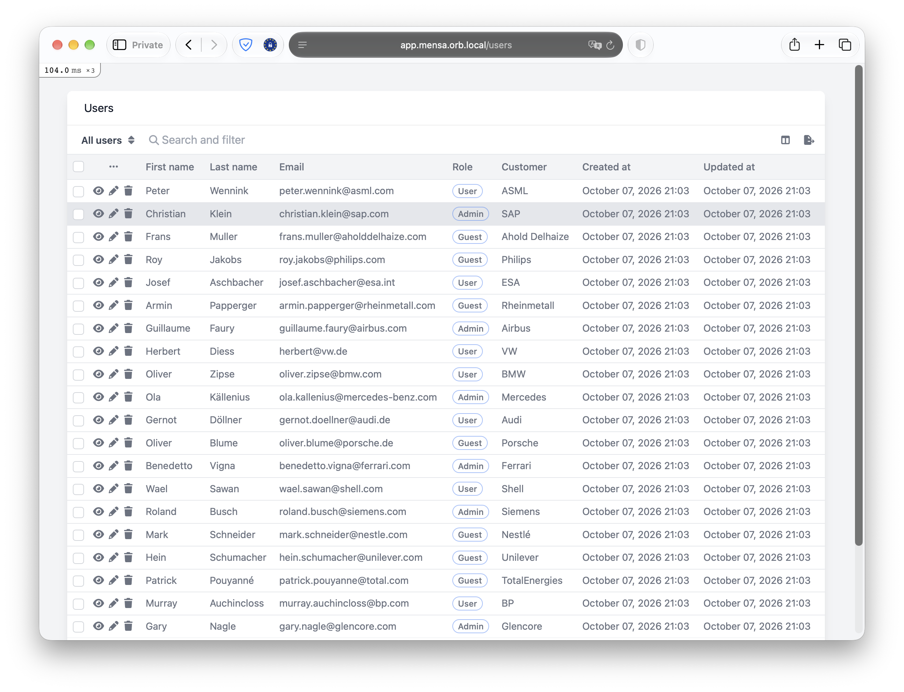
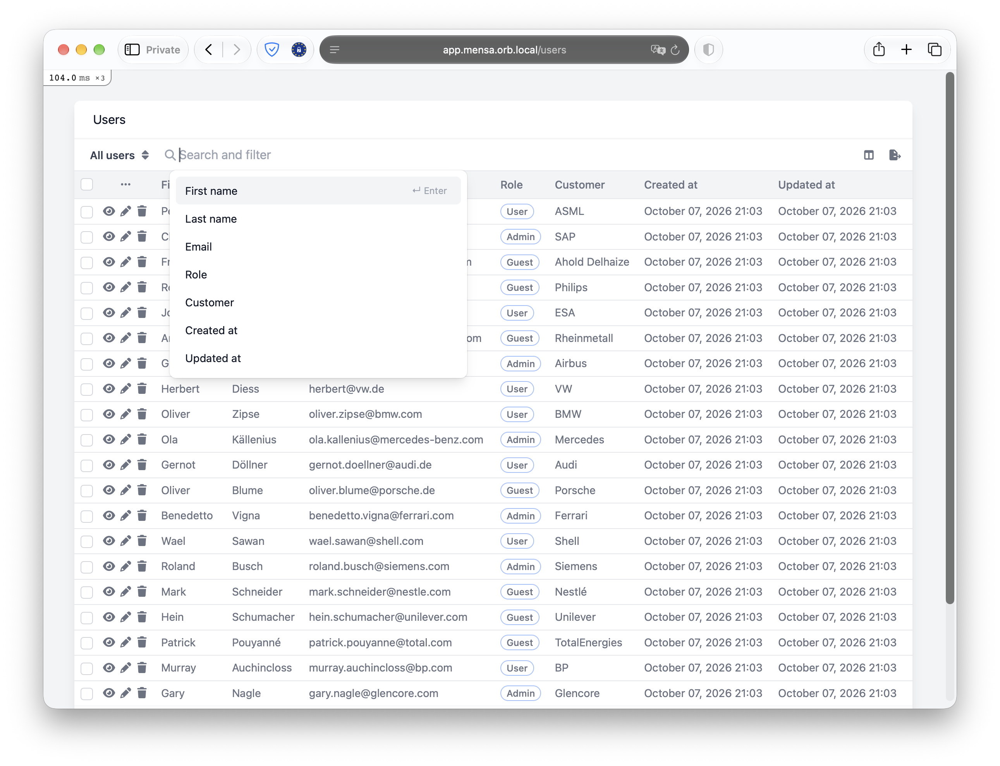
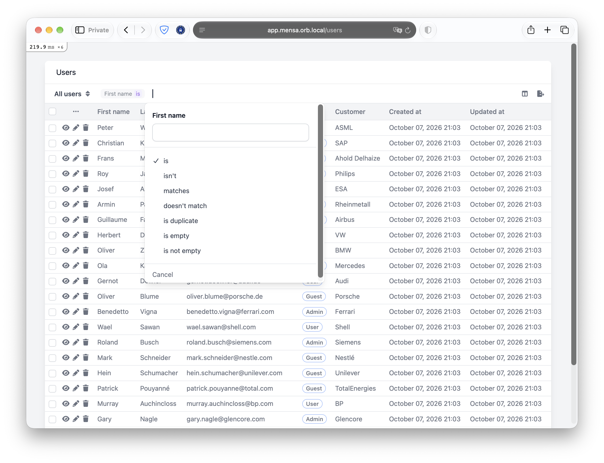
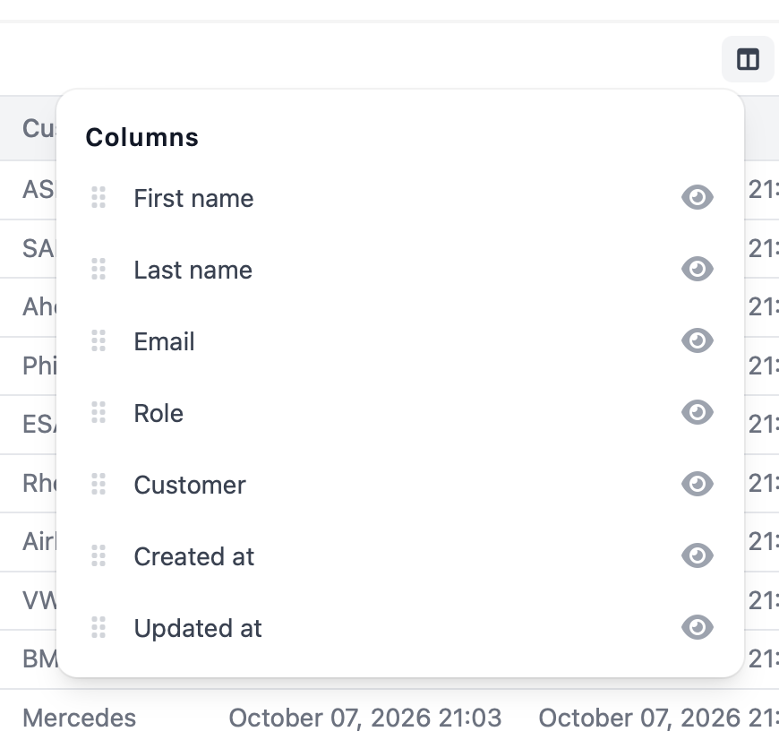
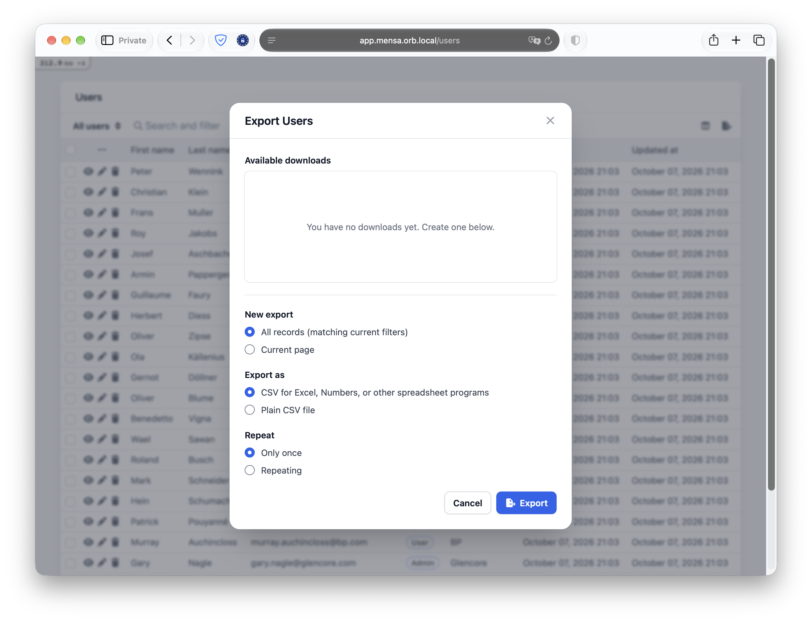

# Mensa

Fast and awesome tables, with pagination, sorting, filtering, batch processing, column hiding, column ordering and custom views.
Due to search, it only works with postgresql at the moment.







Features:
- [x] Very fast
- [x] Row-links
- [x] Sorting
- [x] Filtering of multiple columns
- [X] Hide filter icon in case there are no filters
- [X] Column ordering
- [X] Editing of existing filters
- [X] View selection and exports per view
- [X] Multiple selection of rows and batch processing
- [x] Tables without headers (and without most of the above)
- [X] Search works on all table columns
- [X] Exports can be scheduled to run recurring (daily/weekly/monthly/quarterly/bi-yearly/yearly)
      You will have to bring your own mailer, see configuration for details.
- [X] Grouping rows by a column, with collapsible groups and count/sum/min/max per group

## Usage

Add tables in your app/tables folder, inheriting from ApplicationTable.
This in turn should inherit from Mensa::Base.

You can give columns an arbitrary name, it can match the database column, translations will be taken from `activerecord.attributes.<model>.<column>`:

```yaml
en: 
  activerecord:
    attributes:
      user:
        name: Full name
```

```ruby
class UserTable < ApplicationTable
  model User # implicit from name

  order name: :desc

  column(:name) do
    filter
  end

  column(:nr_of_roles) do
    attribute "roles_count" # We use a database column here
  end

  # Customize how a cell looks. Each cell is wrapped in a <td>, unless the html
  # block returns its own td, so you can style the td itself.
  column(:state) do
    render do
      html do |user|
        content_tag(:td, user.human_state_name, class: "state state--#{user.state}")
      end
    end
  end

  # You can add one or more actions to a row
  action :delete do
    title "Delete row"
    link { |user| user_path(user) }
    icon "fa-regular fa-trash"
    # You could also give it a block, which takes the record as an argument, to choose icons dynamically
    # icon { |product| product.inventory? ? "fal fa-shelves" : "fal fa-shelves-empty" }
    link_attributes data: {"turbo-confirm": "Are you sure you want to delete the user?", "turbo-method": :delete}
    show ->(user) { true }
  end

  link { |user| edit_user_path(user) }

  show_header true
  view_columns_ordering false # Disabled for now

  # Add system views
  # Mensa will always create a systemview (:default) with name 'All' showing all records. 
  # If you want to rename it, for example because you don't show all records in your default scope, or override it with filters, add it and give it a name like below.
  view :default do
    name "Default"
    description "Some descriptive text"
  end
  view :concept do
    name "Concept"
    filter :state do
      operator :is
      value "concept"
    end
  end
  
  batch :confirm do
    description "Confirm users"
    process do |records|
      ConfirmUsersJob.perform_later(records.to_a)
    end
  end

  scope do
    User.all
  end
end
```

You can show your tables on the page using the following:

```erb
<%= table :users %>
```

#### Custom views

Custom views are views not defined by the developer (SystemViews) but by the end-user by adding/removing filters.
When you enable these, they are stored in the database and can be used across sessions, by the user who created them.

### Sortable and filterable columns

Sorting and filtering happen in SQL, so whether a column can be sorted or filtered
depends on whether it has SQL: a database column of the model, or an `attribute`.

- **Columns with SQL** are sortable and filterable by default. Turn that off with
  `sortable false` or `filter false`.
- **Columns without SQL**, which only show something with a `render` block or a
  `method`, are *not* sortable or filterable by default. Their headers have no sort
  link, they aren't offered in the filter menu, and sorting or filtering on them
  from a URL or saved state is ignored.

```ruby
column(:email)                      # sortable and filterable
column(:customer_name) do           # sortable and filterable, it has SQL
  attribute "customers.name"
end
column(:avatar) do                  # render only: not sortable, not filterable
  render do
    html { |user| image_tag(user.avatar_url) }
  end
end
```

To make a column without SQL filterable, give its filter a `scope` (see "Custom
filter scopes" below). Add `sortable true` only when its name can be sorted on in
SQL, e.g. an alias your table's `scope` selects:

```ruby
column(:orders_count) do
  sortable true # ORDER BY orders_count, selected in the scope below
end

scope { User.left_joins(:orders).group(:id).select("users.*, COUNT(orders.id) AS orders_count") }
```

Better still, give such a column an `attribute`, so it's sortable and filterable.

### Filters

Columns with SQL are filterable (see above). Use `filter` to configure how. By
default Mensa compares the column's attribute with the chosen value, using
operators that fit the column type. The filter block takes these options:

```ruby
column(:role) do
  filter do
    collection -> { User::ROLES }  # Values to choose from (array or proc)
    multiple true                  # Allow choosing several values
    operators [:is, :isnt]         # Limit the operators users can pick
    operator :isnt                 # Default operator
    having true                    # Filter with HAVING, for aggregate attributes
  end
end
```

The operators are `is`, `isnt`, `matches`, `does_not_match`, `gt`, `gteq`, `lt`,
`lteq`, `is_duplicate`, `is_current`, `is_empty` and `isnt_empty`. Without an
`operators` list, a column gets the ones that work for its type in SQL:

| Column type | Operators besides `is_duplicate`, `is_empty` and `isnt_empty` |
|---|---|
| string, text, citext, or an `attribute` without `type` | `is`, `isnt`, `matches`, `does_not_match` |
| integer, float, decimal, time | `is`, `isnt`, `gt`, `gteq`, `lt`, `lteq` |
| date, datetime | `gt`, `gteq`, `lt`, `lteq` |
| boolean, uuid, enums and other types | `is`, `isnt` |
| jsonb, json | none (json also has no `is_duplicate`) |

`matches` finds rows where the column contains the value anywhere, ignoring case
(`ILIKE '%value%'`), and `does_not_match` finds the others, including rows where the
column is empty (NULL). The value is taken literally: `%`, `_` and `\` are matched as
characters, not as wildcards. A blank value matches only empty strings.

`matches` and `does_not_match` are left out when the filter has a `collection`, and
`is_current` is only offered when `Current` has a method named after the column.

Mensa reads the type from the database column. Give an `attribute` that isn't text a
`type`, otherwise it's treated as text and gets the text operators:

```ruby
column(:has_orders) do
  attribute "EXISTS (SELECT 1 FROM orders WHERE orders.user_id = users.id)"
  type :boolean
end
```

An `operators` list is used as given, also when it lists operators the type can't run.

#### Custom filter scopes

When comparing the attribute isn't enough, give the filter a `scope`. It runs on the
table's scope and receives the chosen value, an array when `multiple` is set:

```ruby
column(:account_names) do
  attribute %((SELECT STRING_AGG(accounts.name, ', ') FROM accounts WHERE accounts.id = ANY(containers.account_ids)))
  filter do
    collection -> { Account.order(:name).pluck(:name) }
    multiple true
    operators [:is]
    scope ->(value) { where("containers.account_ids && ARRAY[:ids]::uuid[]", ids: Account.where(name: Array(value)).pluck(:id)) }
  end
end
```

To support more operators, accept the operator (a symbol) as a second argument:

```ruby
filter do
  operators [:is, :isnt, :is_empty]
  scope ->(value, operator) {
    case operator
    when :isnt then where.not(account_id: value)
    when :is_empty then where(account_id: nil)
    else where(account_id: value)
    end
  }
end
```

### Grouping

Rows can be shown in groups, each with a header that shows the group's value and
number of rows, and that collapses the group when clicked. Mark the columns users
may group by with `groupable`, and the aggregates they may choose per column with
`aggregates` (any of `:count`, `:sum`, `:min` and `:max`). Users pick both from the
group button in the control bar; their choice is remembered and saved with custom views.

```ruby
column(:status) do
  groupable true
end

column(:amount) do
  aggregates :sum, :min, :max
end

# Optional defaults, also possible per view
group_by :status
aggregates amount: :sum
```

Both need an SQL attribute: a database column, or an `attribute` expression. Rows are
sorted by the group column first (in the direction it is sorted, ascending otherwise),
then by the chosen order. Counts and aggregates are calculated with SQL `GROUP BY` over
all filtered rows, so they cover the whole group, also when it continues on the next page.

### Fast

Mensa selects only the data it needs, based on the columns. Sometimes it needs additional columns to do it's work, but you don't want them displayed. This can be done by adding `internal true` to the column definition, or shorter: use `internal` instead. If your table scope joins an association, Mensa also auto-adds the foreign key column as internal when it is needed.

```ruby
internal :born_on
column :age do
  attribute "EXTRACT(YEAR FROM AGE(born_on))::int" # here born_on is used internally, so we ned to select is
end
```

## Development

### Coding

- Checkout this repo
- Setup your direnv, add the following to your `mise.toml`:

  ```
  [tools]
  node = "24"
  ruby = "3.4.7"
  
  [env]
  RUBY_VERSION="3.4.7"
  ```

- Run `direnv allow`
- Run `overmind s`

### Docs

Using the following in your view will render Mensa::Table::Component
```erb
<%= table :users %>
```

## Installation

Add this line to your application's Gemfile:

```ruby
gem "mensa"
```

And then execute:

```bash
$ bundle
```

Or install it yourself as:

```bash
$ gem install mensa
```

Always use `bundle` to install the gem. Next use the install generator to install migrations, add an initializer and do other setup:

```bash
$ rails g mensa:install
$ rails mensa:install:migrations
```

Next you can run the generator to generate a table:

```bash
$ rails g mensa:table:generate <model_name>
```

### Table params

A table can be built with extra params, for example when its scope or columns
depend on a record:

```erb
<%= table :query_results, params: {query_id: @query.id} %>
```

They are available as `params` inside the table (e.g. `params[:query_id]`) and
are sent along whenever Mensa rebuilds the table: paging, filters, views, batch
actions and exports (including recurring exports, which store them on the
`Mensa::Export`). Exports and the state the browser remembers (filters, order,
columns) are kept per table *and* params.

### Exports

Exporting is built into the table's control bar. Clicking the export button opens
a dialog that lists the user's previous downloads and lets them request a new
export (scope and CSV format). 

#### Export callbacks

Configure callbacks in your Mensa initializer to act on exports, for example to
email the user once their download is ready:

```ruby
Mensa.setup do |config|
  config.callbacks = {
    export_started: ->(export) {},
    export_completed: ->(export) { ExportMailer.with(export: export).ready.deliver_later }
  }
end
```

`export_completed` was called `export_complete` before 0.6.12; that name still
works. Unknown callback names are logged as a warning.

#### Repeating exports

The user can choose to export a table on a regular basis (daily, weekly, monthly, quarterly, bi-yearly, yearly).

When the user selects a repeating export, the table will be exported automatically on the specified schedule.

For this to work you need to have a cron job which runs daily.
When using `sidekiq-cron` or `goodjob` the `RecurringExportsJob` needs to be scheduled to run daily.

If you're just using cron, you can add the following to your crontab:
```
0 0 * * * rails runner "Mensa::RecurringExportsJob.perform_later"
```

### Verifying tables

`Mensa::Verifier` checks that everything a table configures works against your
real database, using the same code paths as requests do:

- **Loads**: the table builds, its SQL builds and the first and last pages load. A
  default `order` or `column_order` naming an unknown column fails. Records are
  sampled for the checks below: some from the first and the last page, and one with
  an empty value for each column, which often breaks render blocks.
- **Columns**: every column (internal ones too) can be selected and, when sortable,
  sorted both ways. Its html and csv renders run for the sampled records, and a
  failure names the record. Columns hidden by a `visible` lambda are reported as
  skipped.
- **Filters**: every filterable column is applied with each of its operators, using
  the first values of its `collection` or a value that fits the column's type, and
  with input the column's type can't hold (e.g. "not a number"). The filter pill's
  text is built. `is_current` is skipped when `Current` has no value for the column.
- **Search**: basic and fuzzy search (when `pg_trgm` is enabled) for a word taken
  from the records.
- **Rendering**: the `table` helper as your views call it, the rows and filter pills
  as Mensa's controller renders them, the row link and every row action.
- **Exports**: `Mensa::ExportJob` generates the first page of the export, also for
  each view and as a password protected zip. It needs the expected headers
  (skipped for `exportable false`).
- **Column order and visibility**: the columns shown, rendered and exported in a
  reversed order, with an order that lists only one column (like browser state or a
  view saved before the other columns were added, which must still show them all),
  with each column hidden and with all of them hidden.
- **Combined**: search, a filter on every column, sorting on every column and
  grouping with aggregates, all at once.
- **Grouping**: every groupable column and every aggregate, rendered with their
  group headers. A `group_by` or `aggregates` naming a column that doesn't allow
  it fails, because Mensa would silently ignore it.
- **Views**: system views load, render and only refer to existing columns. With
  custom views enabled, saved views load too, and a custom view is created like a
  user saving the table's state would (search, filters, sorting, column order, a
  hidden column and grouping), then validated, replayed and exported. It's never
  saved, and needs a user to own it (`user:`).

It also warns, without failing:

- **N+1 queries**: a query that a render block, the row link or a row action runs for
  each record. The warning shows the query and how to avoid it for the association
  it loads, e.g. preload it with `includes` (and `internal :customer_id`, since Mensa
  only selects the table's columns), select the value in SQL with `attribute`, or
  count in SQL. When none is found, the report confirms it under Rendering, e.g.
  `✓ N+1 queries: none in 18 renders of 7 sampled records`. It needs at least two
  records to tell.
- **Untyped attributes**: an `attribute` without `type` whose SQL isn't text, e.g. a
  boolean `EXISTS (...)`. The warning names the `type` to add.
- **Slow queries**: queries that take `config.verifier_slow_query` seconds (1.0 by
  default) or more.

Pass `strict: true` (or `STRICT=1` to rake) to make warnings fail.

Each check runs on its own, so one failure doesn't hide the others. Everything runs
in a read-only transaction that is rolled back, with small limits, so it is safe to
run against staging. It never writes.

#### From rake

```sh
bin/rails "mensa:verify[inventories]"   # or InventoriesTable
bin/rails mensa:verify_all              # every table in app/tables
```

The tasks print a report of the failures (✗, with the error and SQL) and warnings (!)
and exit non-zero when a check failed. Add `-v`/`--verbose` (or `VERBOSE=1`) to list
every check (✓ passed, - skipped):

```sh
bin/rails "mensa:verify[inventories]" -v
```

Classes and modules that don't descend from `Mensa::Base` (e.g. helpers in
`app/tables`) are skipped, and only reported as such with `-v`.

#### From tests

```ruby
# test/test_helper.rb or spec/rails_helper.rb
require "mensa/testing"

# Minitest
assert_mensa_table_valid InventoriesTable, user: users(:admin)

# RSpec
expect(InventoriesTable).to be_a_valid_mensa_table(user: admin)

# Plain Ruby
result = Mensa::Verifier.new(InventoriesTable, user: admin).call
result.success?  # => true
result.failures  # => [#<struct Mensa::Verifier::Check section: :filters, subject: :status, ...>]
puts result      # the report, also the failure message of the helpers
```

#### Context

Tables often depend on the request: `Current.user`, policy scopes, or the table's
params. Give the verifier that context:

- `user:` and `account:` set `Current.user` and `Current.account` while verifying.
- `context: {organization: org}` sets any other `Current` attributes.
- `params: {customer_id: 1}` sets the table's params (see "Table params").
- A block is called with the verifier before the checks, for any other setup.
- `label: "admin"` names the context in the report.

Html render blocks run in a view context of your `ApplicationController` (see
`config.base_controller`), so url helpers and your helpers work.

From rake, set `USER_ID=` (finds a `User`), `ACCOUNT_ID=` (finds an `Account`) and
`PARAMS='{"customer_id":1}'` (JSON), or configure defaults for every table in
your initializer. The options you pass yourself override these defaults. Return an array of them to
verify every table once for each, e.g. as different kinds of users:

```ruby
Mensa.setup do |config|
  config.verifier_context = ->(table_class) {
    params = {customer_id: Customer.first.id} if table_class == CustomerUsersTable
    [
      {label: "admin", user: User.find_by!(email: "admin@example.com"), params: params},
      {label: "customer", user: User.find_by!(email: "customer@example.com"), params: params}
    ]
  }
end
```

## Contributing

Contribution directions go here.

## License
The gem is available as open source under the terms of the [MIT License](https://opensource.org/licenses/MIT).
